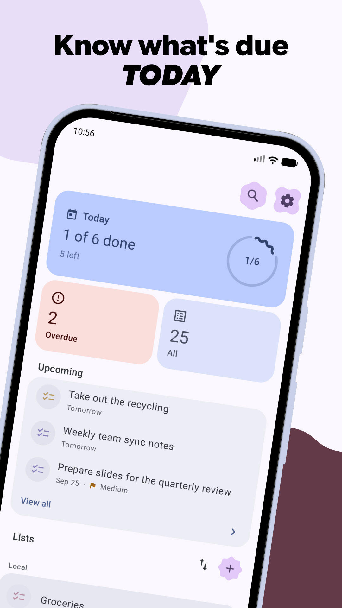
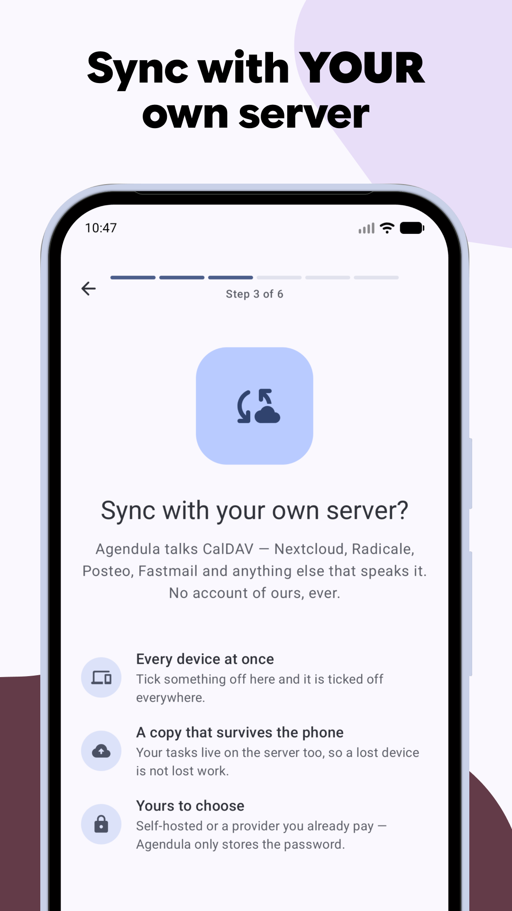
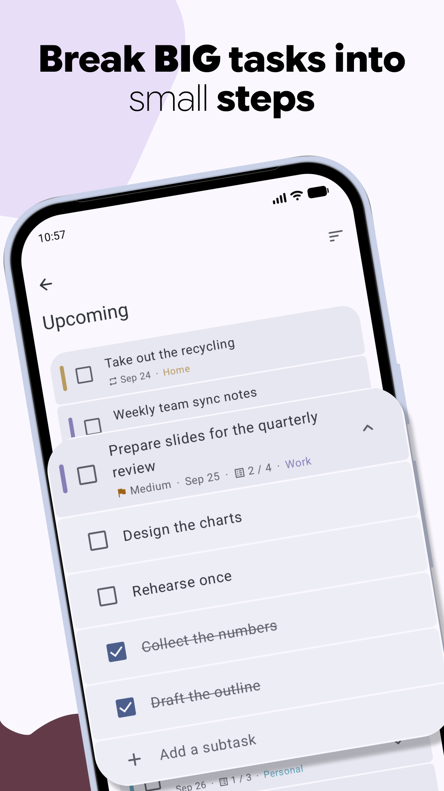
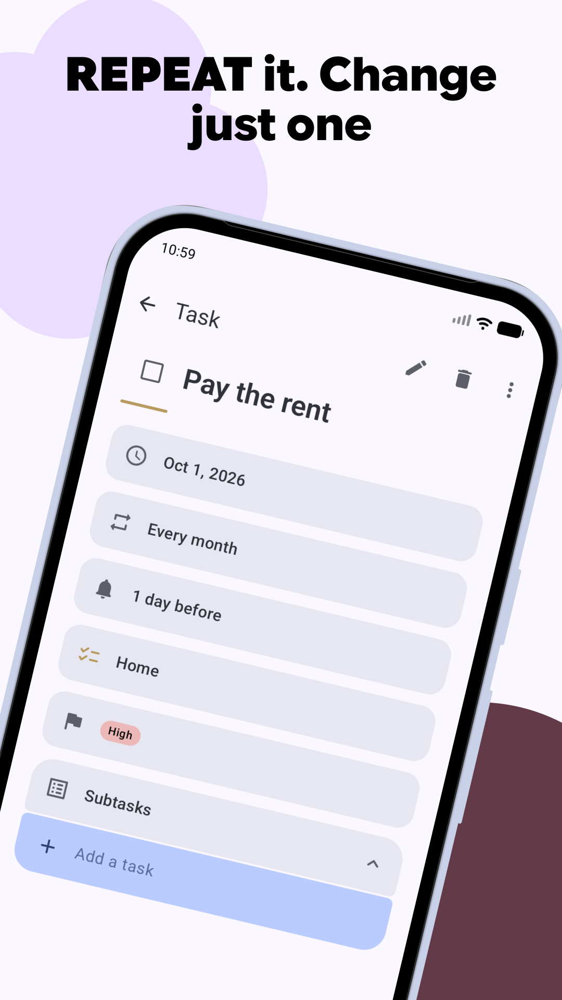

<div align="center">

<h1>Agendula</h1>

<p><strong>A modern Material 3 Expressive task app for Android.</strong><br>
Syncs over CalDAV, or keeps your tasks on the device. Open standards, no account
required.</p>

<p>
<a href="https://codeberg.org/jlmakiola/agendula/actions"></a>


<a href="LICENSE"></a>
</p>

<p>
<a href="https://apps.obtainium.imranr.dev/redirect?r=obtainium://add/https://codeberg.org/jlmakiola/agendula"></a>
&nbsp;
<a href="https://ko-fi.com/jeanlucmakiola"></a>
</p>

<p>





</p>

</div>

Agendula is the task-list sibling to [Calendula](https://codeberg.org/jlmakiola/calendula).
It keeps its own task store, designed around RFC 5545's `VTODO`, and syncs it
with any CalDAV server — Nextcloud, Radicale, Baïkal and the rest. No account is
needed to use it: without one, your tasks simply stay on the phone.

The name rhymes with its sibling on purpose: **Agendula** is *agenda* — Latin for
“things to be done” — given Calendula's `-ula` ending. Calendula keeps your days;
Agendula keeps your to-dos. (A Calendula flower head is botanically a cluster of
many small *florets* — so the two apps are florets of one bloom.)

## What it does

- **Lists** you create, colour, reorder and delete in the app, plus smart lists:
  Today, Upcoming, Overdue, No date, All and Completed.
- **Tasks** with due and start dates, all-day tasks, subtasks, priorities,
  progress, location and URL, and cancel/restore.
- **Repeating tasks**, expanded per RFC 5545. Edit or delete one occurrence,
  this and the following ones, or the whole series.
- **Reminders** that fire at the exact time: several per task, separate defaults
  for timed and all-day tasks (globally and per list), Done and Snooze right on
  the notification, and they survive reboots.
- **iCalendar import and export** — open an `.ics` or a zip of them, or write any
  list out as standard `.ics` files.
- A **home-screen widget**, launcher shortcuts, a Quick Settings tile, and
  "share to Agendula" to turn text from another app into a task.
- **Material 3 Expressive** throughout, with dynamic colour, expressive motion
  and shapes.

## Sync

Add a CalDAV account under **Settings → Accounts** and choose which of its task
lists to sync. Nextcloud signs in through its own login flow in the browser, so
Agendula never sees your password; any other server takes an address, a user
name and a password — ideally an app password, which you can revoke on its own.

Edits you make are sent within about half a minute. Changes from the server
arrive on a background interval you choose (15 minutes to a day, or only when
you tap sync), and every time you open the app. Several accounts can sync side
by side, and lists can be created, renamed and deleted on the server from the
app.

Sync uses `sync-collection` (RFC 6578) where the server supports it and falls
back to a full comparison where it does not. Everything the store does not model
is kept verbatim and sent back unchanged, so passing your tasks through Agendula
does not quietly lose fields another client wrote.

## Where your tasks live

|  | Where | Sync | Needs |
|---|---|---|---|
| **In Agendula** *(default)* | Agendula's own database | Agendula's own CalDAV sync, if you add an account | nothing — no permissions, no other app |
| **In a provider you already use** | OpenTasks or tasks.org | whatever syncs it for you — DAVx5 and friends | that app installed, and its read/write permission |

Agendula's own store is an ordinary app database, so it **coexists with
OpenTasks rather than replacing it**. If you already sync through a provider,
Agendula can work on top of it exactly as before.

Switching between the two moves nothing — each store keeps its own tasks — so
**Settings → Storage** asks before it switches, and offers to **copy** a
provider's tasks into Agendula's own store when you want to move over. The copy
is taken once and the originals stay where they are.

Google Tasks and Microsoft To Do are out of scope by design: they are
proprietary, and open standards — CalDAV and iCalendar — are the lane.

## Install

### F-Droid repository

Every release is built, signed and published to a self-hosted F-Droid
repository. Add it once and your F-Droid client handles updates from then on:

1. In your F-Droid client, open *Settings → Repositories → Add* (or open the
   link below on your phone):

   ```
   https://apps.dev.jeanlucmakiola.de/dev/fdroid/repo?fingerprint=C2C0640402BF458FC0ED957AF0B37AA4C14022E72F89CE90B5965B458CF73425
   ```

2. Refresh, search for **Agendula**, install.

### Codeberg release / Obtainium

Every release is also published on
**[Codeberg](https://codeberg.org/jlmakiola/agendula/releases)** with the signed
APK and a `.sha256` checksum attached — the same APK the F-Droid repository
serves. For automatic updates from there, use
**[Obtainium](https://github.com/ImranR98/Obtainium)** and
**[add Agendula in one tap](https://apps.obtainium.imranr.dev/redirect?r=obtainium://add/https://codeberg.org/jlmakiola/agendula)**.
Betas of upcoming versions are published there too, as pre-releases; to test
them, switch on *Include prereleases* for Agendula in Obtainium.

### Build from source

```sh
git clone --recurse-submodules https://codeberg.org/jlmakiola/agendula.git
cd agendula
./gradlew :app:assembleDebug
```

JDK 17 and the Android SDK are all it needs; see
[`CONTRIBUTING.md`](CONTRIBUTING.md) for tests and lint.

## Translations

Translations are managed on a self-hosted **Weblate**, and partial ones are
fine — an untranslated string simply falls back to English. Agendula ships in
English, German and Brazilian Portuguese so far.

**→ [Help translate Agendula](https://weblate.dev.jeanlucmakiola.de/engage/agendula/)**

No coding needed: register on the Weblate server, pick (or request) a language,
and translate the strings in your browser. You can also reach this link in the
app from the top of **Settings → App language**.

## Contributing

Issues and pull requests live on
**[Codeberg](https://codeberg.org/jlmakiola/agendula)**.
[`CONTRIBUTING.md`](CONTRIBUTING.md) covers the practical how.

## Privacy

No analytics, no advertising, no tracking, no third-party SDK, and no server of
the developer's. Your tasks stay on your device unless you add a CalDAV account
yourself, and then they go only to the server you chose.

**→ [Privacy policy](https://jeanlucmakiola.de/agendula/privacy)**

## License

MIT — see [LICENSE](LICENSE).
