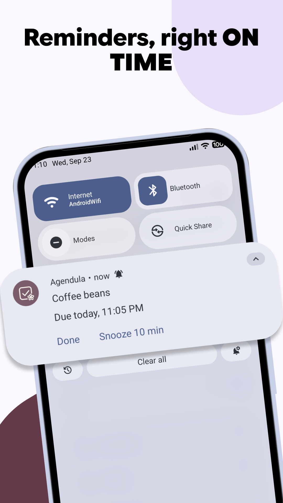

<div align="center">

<h1>Agendula</h1>

<p><strong>A modern Material 3 Expressive task app for Android.</strong><br>
Syncs over CalDAV, or keeps your tasks on the device. Open standards, no account
required.</p>

<p>


<a href="LICENSE"></a>
</p>

<p>



</p>

</div>

**English | [简体中文](README.zh.md)**

> **This is a fork.** The app itself is
> [Agendula](https://codeberg.org/jlmakiola/agendula) by
> [Jean-Luc Makiola](https://codeberg.org/jlmakiola), released under the MIT
> licence. This fork is maintained by **AieXile** and published under its own
> application id, `com.aiexile.agendula`, so it installs and updates
> independently of the original. See [FORK.md](FORK.md) for what changed and
> which licence obligations come with the fork, and [LICENSE](LICENSE) for the
> notices that must travel with any redistribution.

Agendula keeps its own task store, designed around RFC 5545's `VTODO`, and syncs
it with any CalDAV server — Nextcloud, Radicale, Baïkal and the rest. No account
is needed to use it: without one, your tasks simply stay on the phone.

**Agendula** is *agenda* — Latin for "things to be done" — named in the style of
its upstream sibling [Calendula](https://codeberg.org/jlmakiola/calendula). A
Calendula flower head is botanically a cluster of many small *florets*, and the
two apps share a component library, `floret-kit`.

## What it does

- **Lists** you create, colour, reorder and delete in the app, plus smart lists:
  Today, Upcoming, Overdue, No date, All and Completed.
- **Tasks** with due and start dates, all-day tasks, subtasks, priorities,
  progress, location and URL, and cancel/restore.
- **Repeating tasks**, expanded per RFC 5545. Edit or delete one occurrence,
  this and the following ones, or the whole series.
- **Reminders** that fire at the exact time: several per task, separate defaults
  for timed and all-day tasks (globally and per list), Done and Snooze right on
  the notification, and they survive reboots. They sync as standard `VALARM`s,
  so they also ring in other CalDAV clients, and theirs ring here.
- **iCalendar import and export** — open an `.ics` or a zip of them, or write any
  list out as standard `.ics` files.
- A **home-screen widget**, launcher shortcuts, a Quick Settings tile, and
  "share to Agendula" to turn text from another app into a task.
- **Material 3 Expressive** throughout, with dynamic colour, expressive motion
  and shapes.

## Sync

Add a CalDAV account under **Settings → Accounts** and choose which of its task
lists to sync. Nextcloud signs in through its own login flow in the browser, so
Agendula never sees your password; any other server takes an address, a user
name and a password — ideally an app password, which you can revoke on its own.

Edits you make are sent within about half a minute. Changes from the server
arrive on a background interval you choose (15 minutes to a day, or only when
you tap sync), and every time you open the app. Several accounts can sync side
by side, and lists can be created, renamed and deleted on the server from the
app.

Sync uses `sync-collection` (RFC 6578) where the server supports it and falls
back to a full comparison where it does not. Everything the store does not model
is kept verbatim and sent back unchanged, so passing your tasks through Agendula
does not quietly lose fields another client wrote.

### Tested With

| Service | Version | Date | Status | User |
|---|---|---|---|---|
| **Nextcloud** | 25.0.0 | Oct 9th 2026 | ✅ | [@jlmakiola](https://codeberg.org/jlmakiola) [@Schanbro](https://codeberg.org/Schanbro) |

## Where your tasks live

|  | Where | Sync | Needs |
|---|---|---|---|
| **In Agendula** *(default)* | Agendula's own database | Agendula's own CalDAV sync, if you add an account | nothing — no permissions, no other app |
| **In a provider you already use** | OpenTasks or tasks.org | whatever syncs it for you — DAVx5 and friends | that app installed, and its read/write permission |

Agendula's own store is an ordinary app database, so it **coexists with
OpenTasks rather than replacing it**. If you already sync through a provider,
Agendula can work on top of it exactly as before.

Other apps can read and write the tasks in Agendula's own store through an
OpenTasks-compatible provider, once you grant them permission. See
[docs/CONTENT_PROVIDER.md](docs/CONTENT_PROVIDER.md).

Switching between the two moves nothing — each store keeps its own tasks — so
**Settings → Storage** asks before it switches, and offers to **copy** a
provider's tasks into Agendula's own store when you want to move over. The copy
is taken once and the originals stay where they are.

Google Tasks and Microsoft To Do are out of scope by design: they are
proprietary, and open standards — CalDAV and iCalendar — are the lane.

## Install

This fork is distributed only as
[GitHub releases](https://github.com/AieXile/Agendula/releases) — there is no
F-Droid or Google Play listing, and no store metadata in this repository. The
original Agendula entries on F-Droid and Play install the upstream app, with a
different application id, and are not updated by this fork. To run this fork,
install a release APK or build it yourself:

```sh
git clone --recurse-submodules https://github.com/AieXile/Agendula.git
cd Agendula
./gradlew :app:assembleDebug
adb install app/build/outputs/apk/full/debug/app-full-debug.apk
```

Tagging `vX.Y.Z` builds, signs and attaches the release APKs — one universal
APK per flavour, no per-ABI splits — to
[GitHub releases](https://github.com/AieXile/Agendula/releases). For automatic
updates from that feed, use [Obtainium](https://github.com/ImranR98/Obtainium).

JDK 17 and the Android SDK are all it needs; see
[`CONTRIBUTING.md`](CONTRIBUTING.md) for tests and lint, and
[`docs/RELEASING.md`](docs/RELEASING.md) for signing a release build.

### Offline version

The `offline` flavour is Agendula without CalDAV sync and **without the network
permission**, so it cannot connect to anything. It installs alongside the
regular app rather than replacing it; move tasks between the two with
Settings → Backup & restore → Export / Import.

## Translations

Translations live in this repository (`app/src/main/res/values-*/strings.xml`);
partial ones are fine — an untranslated string simply falls back to English.
Adding or improving a language is a normal pull request; see
[`CONTRIBUTING.md`](CONTRIBUTING.md). You can also reach that link in the app
from the top of **Settings → App language**.

## Contributing

Issues and pull requests live on
**[GitHub](https://github.com/AieXile/Agendula)**.
[`CONTRIBUTING.md`](CONTRIBUTING.md) covers the practical how.

## Privacy

No analytics, no advertising, no tracking, no third-party SDK, and no server of
the developer's. Your tasks stay on your device unless you add a CalDAV account
yourself, and then they go only to the server you chose.

**→ [Privacy policy](docs/PRIVACY.md)**

## License

The fork as a whole is MIT — see [LICENSE](LICENSE), which keeps the original
copyright notice and adds the fork's. Two exceptions travel with the code:

- **`dav/`** is a vendored copy of
  [dav4jvm](https://github.com/bitfireAT/dav4jvm) and stays **MPL-2.0**
  (`dav/LICENSE`). Modified files there must be made available under MPL-2.0,
  and their licence headers must be kept — see [`dav/PROVENANCE.md`](dav/PROVENANCE.md).
- **`floret-kit`** (the submodule component library) is MIT, © Jean-Luc Makiola.

The in-app **Settings → About → Open source licenses** screen lists every third
party component and its licence; keep it current when adding a dependency.
