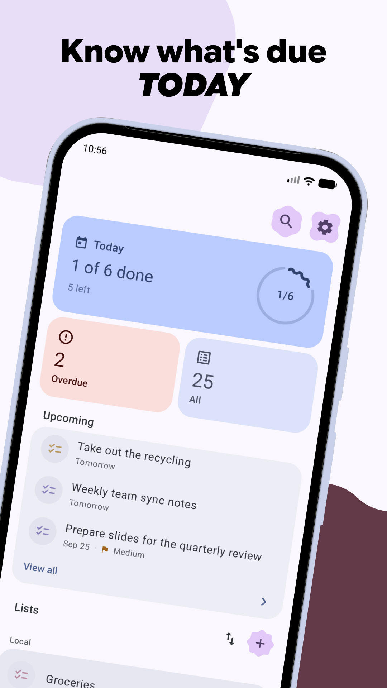
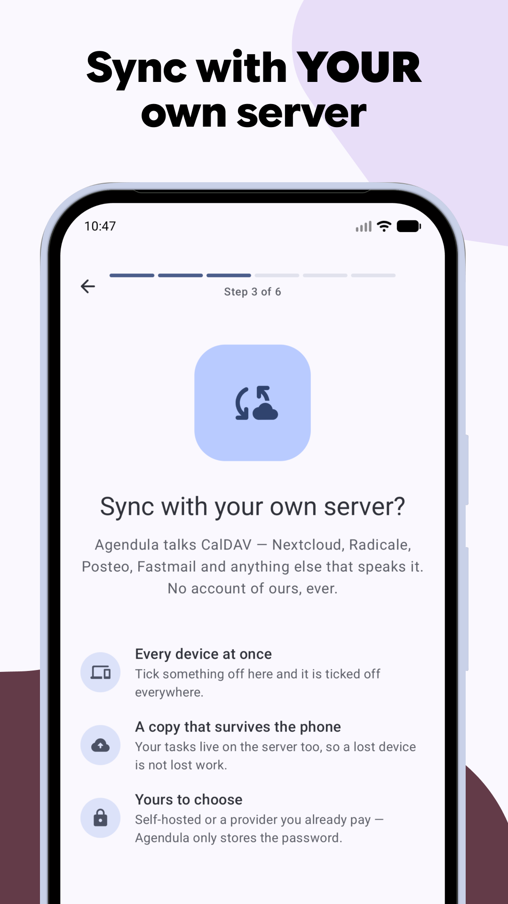
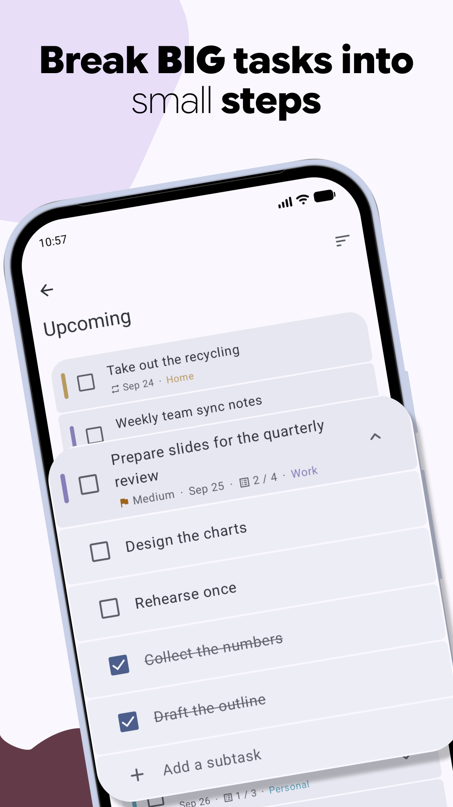
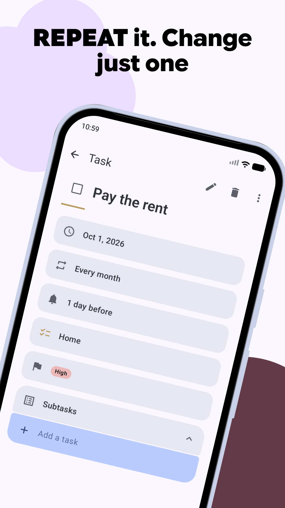
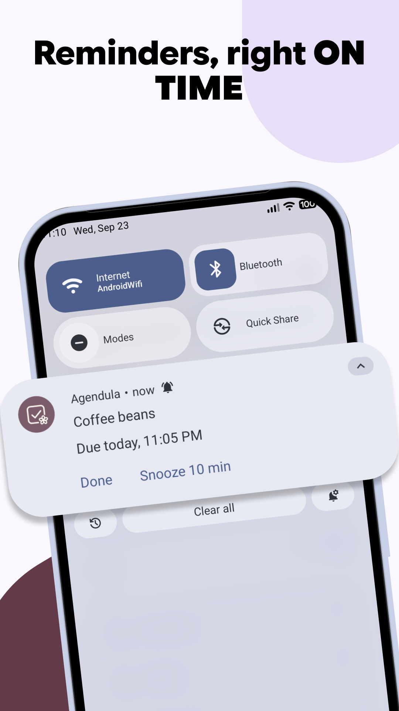

<div align="center">

<h1>Agendula</h1>

<p><strong>面向 Android 的现代 Material 3 Expressive 任务应用。</strong><br>
通过 CalDAV 同步，或把任务留在设备上。开放标准，无需账号。</p>

<p>


<a href="LICENSE"></a>
</p>

<p>





</p>

</div>

**[English](README.md) | 简体中文**

> **这是一个 fork。** 应用本身是
> [Agendula](https://codeberg.org/jlmakiola/agendula)，作者
> [Jean-Luc Makiola](https://codeberg.org/jlmakiola)，以 MIT 许可发布。
> 本 fork 由 **AieXile** 维护，使用自己的应用 ID `com.aiexile.agendula` 发布，
> 因此可与原版并存、独立更新。变更清单与本 fork 附带的许可义务见
> [FORK.md](FORK.md)，任何再分发都必须携带的声明见 [LICENSE](LICENSE)。

Agendula 拥有自己的任务库，围绕 RFC 5545 的 `VTODO` 设计，并能与任意 CalDAV
服务器同步——Nextcloud、Radicale、Baïkal 等都可以。使用它不需要账号：没有账号时，
任务就留在手机上。

**Agendula** 取自 *agenda*——拉丁语「待办之事」——命名风格沿袭上游姊妹项目
[Calendula](https://codeberg.org/jlmakiola/calendula)。Calendula 的花序在植物学上
由许多小花（*florets*）组成，两个应用共用一个组件库 `floret-kit`。

## 功能

- **清单**：在应用内创建、上色、排序和删除，另有智能清单：今天、近期、逾期、
  无日期、全部、已完成。
- **任务**：到期与开始日期、全天任务、子任务、优先级、进度、地点与链接，
  以及取消／恢复。
- **重复任务**：按 RFC 5545 展开。你可以只改／删某一次、本次及之后，
  或整个系列。
- **提醒**：在准确时间触发——每个任务可设多个，定时与全天任务各有独立默认值
  （全局与按清单），通知上直接有「完成」和「稍后提醒」，重启后依然有效。
  提醒会以标准 `VALARM` 同步，因此其它 CalDAV 客户端也会响，它们的提醒也会在这里响。
- **iCalendar 导入导出**：打开 `.ics` 或其 zip 包，或把任意清单导出为标准
  `.ics` 文件。
- **桌面小组件**、启动器快捷方式、快捷设置磁贴，以及「分享到 Agendula」——
  把其它应用里的文字直接变成任务。
- 全界面 **Material 3 Expressive**，支持动态取色、富有表现力的动效与形状。

## 同步

在 **设置 → 账户** 添加 CalDAV 账户，并选择要同步的任务清单。Nextcloud 通过它自己的
浏览器登录流程完成登录，Agendula 始终看不到你的密码；其它服务器只需地址、用户名
和密码——最好是可单独吊销的应用专用密码。

你的修改约半分钟内发出。服务器上的变更按你选择的间隔在后台到达（15 分钟到一天，
或只在你点同步时），每次打开应用也会同步。多个账户可以并存，清单也可以在应用内
于服务器上创建、重命名和删除。

服务器支持时同步使用 `sync-collection`（RFC 6578），不支持时回退到全量比对。
任务库没有建模的字段会原样保留并原样回传，因此让任务经过 Agendula 并不会悄悄丢掉
其它客户端写入的字段。

### 已验证环境

| 服务 | 版本 | 日期 | 状态 | 用户 |
|---|---|---|---|---|
| **Nextcloud** | 25.0.0 | 2026 年 10 月 9 日 | ✅ | [@jlmakiola](https://codeberg.org/jlmakiola) [@Schanbro](https://codeberg.org/Schanbro) |

## 任务存在哪里

|  | 位置 | 同步 | 需要 |
|---|---|---|---|
| **在 Agendula 中** *（默认）* | Agendula 自己的数据库 | 添加账户后由 Agendula 自己的 CalDAV 同步 | 无——不需要权限，也不需要其它应用 |
| **在你已在用的 provider 中** | OpenTasks 或 tasks.org | 由原本负责同步它的应用完成——DAVx5 等 | 安装了该应用，并授予其读写权限 |

Agendula 自己的任务库就是一个普通的应用数据库，因此它**与 OpenTasks 并存，而不是
取代它**。如果你已经在通过 provider 同步，Agendula 仍可像以前一样工作在其之上。

授予权限后，其它应用可以通过兼容 OpenTasks 的 provider 读写 Agendula 自己库中的任务。
见 [docs/CONTENT_PROVIDER.md](docs/CONTENT_PROVIDER.md)。

两者之间切换不会搬运任何数据——每个库保留自己的任务——所以 **设置 → 存储** 在切换前
会询问，并在你想迁移时提供**复制**功能，把 provider 的任务复制进 Agendula 自己的库。
复制只做一次，原数据原样保留。

Google Tasks 与 Microsoft To Do 属于设计上不支持的范围：它们是专有服务，而这项功能
只走开放标准——CalDAV 与 iCalendar。

## 安装

本 fork 只通过 [GitHub Releases](https://github.com/AieXile/Agendula/releases)
分发——没有 F-Droid 或 Google Play 上架，仓库里也没有任何商店元数据。F-Droid
与 Play 上的 Agendula 条目安装的是上游应用（应用 ID 不同），也不会由本 fork 更新。
要运行本 fork，请安装发布版 APK 或自行构建：

```sh
git clone --recurse-submodules https://github.com/AieXile/Agendula.git
cd Agendula
./gradlew :app:assembleDebug
adb install app/build/outputs/apk/full/debug/app-full-debug.apk
```

打 `vX.Y.Z` 标签后会自动构建、签名并把发布 APK 挂到
[GitHub Releases](https://github.com/AieXile/Agendula/releases)——每个 flavor 一份
通用 APK，不按 ABI 拆分。想让更新自动跟进该渠道，可使用
[Obtainium](https://github.com/ImranR98/Obtainium)。

只需要 JDK 17 与 Android SDK；测试与 lint 见 [`CONTRIBUTING.md`](CONTRIBUTING.md)，
签名发布构建见 [`docs/RELEASING.md`](docs/RELEASING.md)。

### 离线版

`offline` flavor 是没有 CalDAV 同步、**也没有网络权限**的 Agendula，因此无法连接任何
东西。它与常规版并存而非替换；两者间用 设置 → 备份与恢复 → 导出／导入 迁移任务。

## 翻译

翻译就在本仓库里（`app/src/main/res/values-*/strings.xml`）；残缺的翻译没有问题——
未翻译的字符串会回落到英文。新增或改进语言都是普通 PR，见
[`CONTRIBUTING.md`](CONTRIBUTING.md)。你也可以在应用内 **设置 → 应用语言** 顶部
找到这个链接。

## 参与贡献

问题反馈与 PR 都在 **[GitHub](https://github.com/AieXile/Agendula)**。
[`CONTRIBUTING.md`](CONTRIBUTING.md) 说明了实际操作方式。

## 隐私

没有统计、没有广告、没有追踪、没有第三方 SDK，也没有开发者自己的服务器。除非你自己
添加 CalDAV 账户，任务只留在你的设备上；添加之后，它们只会去你选择的服务器。

**→ [隐私政策](docs/PRIVACY.md)**

## 许可证

本 fork 整体为 MIT——见 [LICENSE](LICENSE)，其中保留了原始版权声明并加入了本 fork 的
声明。有两处例外随代码同行：

- **`dav/`** 是 [dav4jvm](https://github.com/bitfireAT/dav4jvm) 的内嵌副本，保持
  **MPL-2.0**（`dav/LICENSE`）。其中修改过的文件必须以 MPL-2.0 提供，且必须保留其
  许可头——见 [`dav/PROVENANCE.md`](dav/PROVENANCE.md)。
- **`floret-kit`**（子模块组件库）为 MIT，© Jean-Luc Makiola。

应用内 **设置 → 关于 → 开源许可** 列出了全部第三方组件及其许可；新增依赖时请同步更新。
